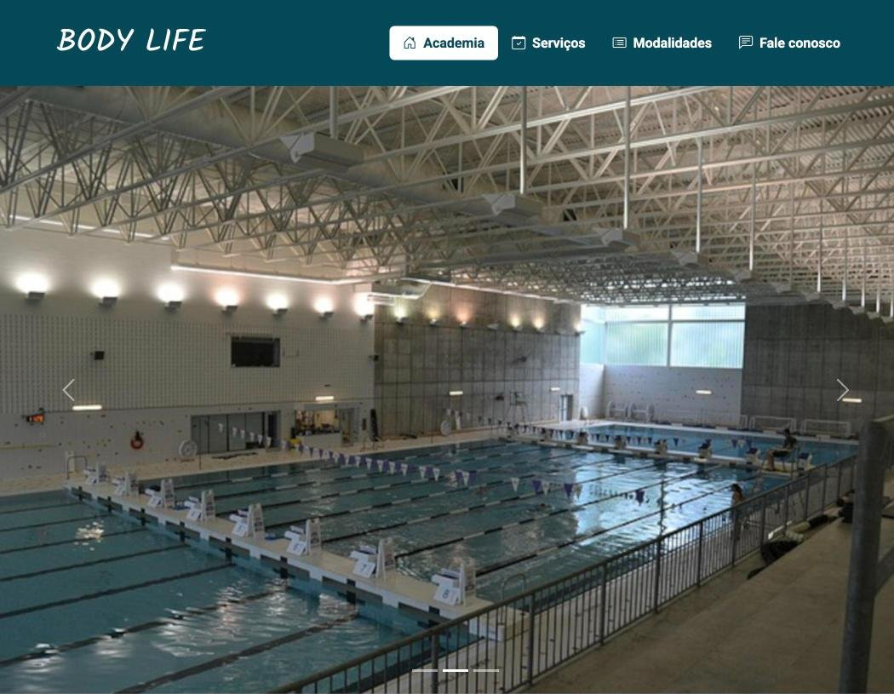
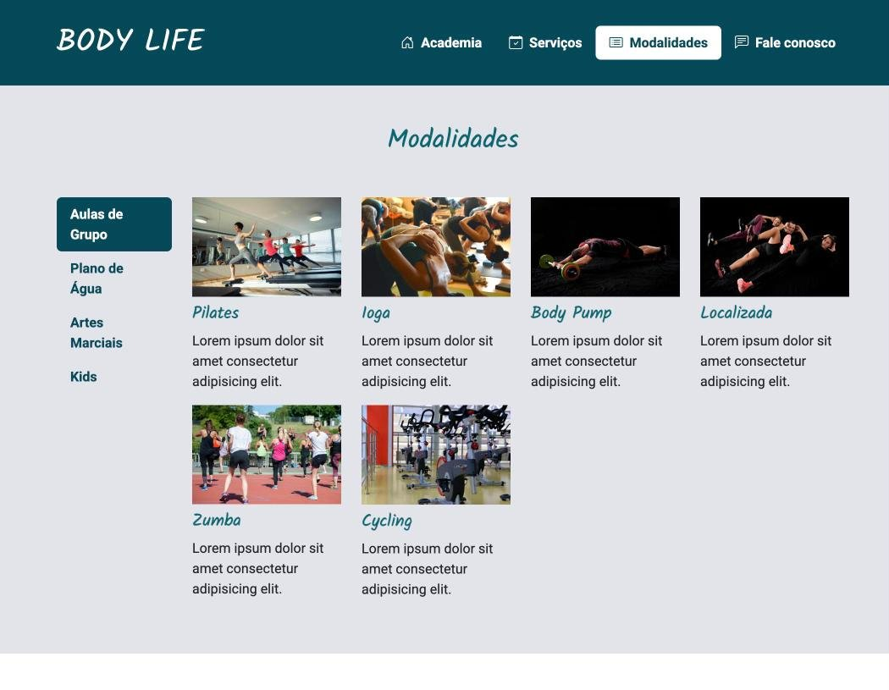
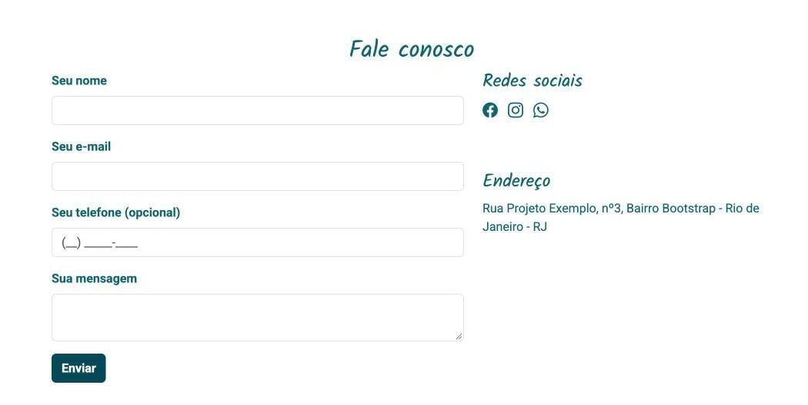

# 🏋️ Body Life — Academia

Site de uma **academia de ginástica**, com menu fixo, carrossel de imagens, secção de diferenciais, serviços, modalidades organizadas em separadores e formulário de contacto com **validação e máscara de telefone**. Construído com **Bootstrap 5** e **jQuery**.

🔗 **Demo:** [site-hsgym.vercel.app](https://site-hsgym.vercel.app)




---

## 📸 Ecrãs

| Modalidades (separadores) | Formulário de contacto |
|---|---|
|  |  |

## ✨ O que pratiquei

- **Bootstrap 5**: `navbar` fixa (`sticky-top`) com menu que colapsa no telemóvel, carrossel e grelha responsiva
- **Separadores (tabs)** com `nav-pills` para as modalidades: Aulas de Grupo, Plano de Água, Artes Marciais e Kids
- **Bootstrap Icons** no menu e nas redes sociais
- **jQuery Validation**: campos obrigatórios, validação de e-mail e mensagens de erro personalizadas
- **jQuery Mask** no campo de telefone
- Tipografia com **Google Fonts** (Kalam e Roboto)
- Publicação do site na **Vercel**

## 📁 Estrutura

```
├── images/      # Fotografias
├── js/
│   ├── main.js  # Máscara e validação do formulário
│   └── …        # Plugins jQuery (Mask, Validate)
├── index.html   # Página
└── main.css     # Estilos personalizados
```

## ▶️ Como ver

Abre o `index.html` no browser ou visita a [demo](https://site-hsgym.vercel.app).

## 📚 Contexto

Projeto desenvolvido no âmbito da formação **Full Stack Java da EBAC** (módulos de Bootstrap e jQuery), em 2023.

---

Desenvolvido por **Hanna Sampaio** · [LinkedIn](https://www.linkedin.com/in/hannasampaio7/) · [GitHub](https://github.com/hannasampaio)
